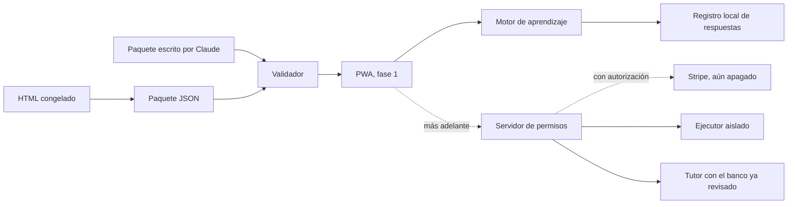
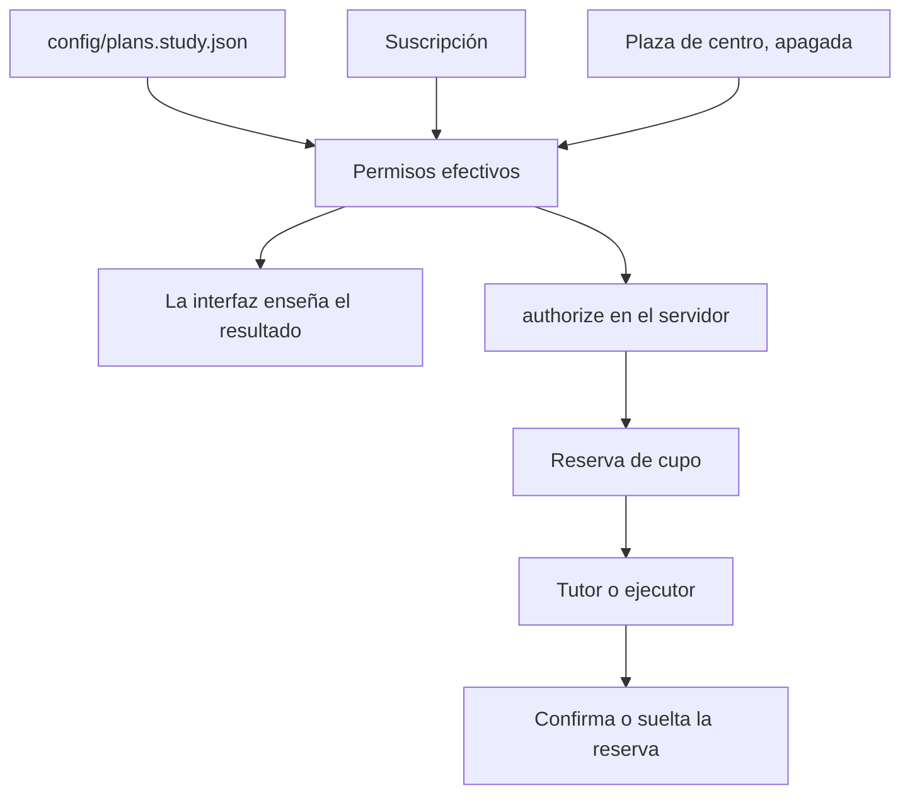

# Arquitectura

## Decisión

La primera versión es una PWA estática, sin servidor. El contenido es JSON validado. El progreso es un registro de respuestas en el dispositivo. El motor de aprendizaje es una función pura, ya especificada en `engine/learning.mjs`, sin interfaz.

Eso cuesta cero y se puede alojar después como archivos estáticos, solo cuando se autorice. No se crea ahora una cuenta en un proveedor, una base de datos, un ejecutor de código ni una pasarela de pago.

El modelo de planes ya está definido para cuando exista servidor. Free incluye el estudio. Pro y Premium añaden personalización y consumo de tutor y de ejecución. Los importes de estudio viven en `config/plans.study.json`, no en la lógica de la aplicación. Stripe figura en ese archivo con `activated: false`.

## Piezas

| Pieza | Ahora | Después |
| --- | --- | --- |
| Fuente congelada | `sources/MiChuleta_DAM_2.0.html`, comprobada por hash | No se edita. Las correcciones son entidades nuevas con estado de revisión |
| Esquemas | `schemas/` | Se versionan. Un paquete declara `schemaVersion` |
| Ejemplo | Un concepto, sus términos y una pregunta | La extracción completa es la fase 1 |
| Validador | `npm run validate` | Misma puerta para cualquier paquete |
| Motor | Leitner, puntuación y prioridad, con pruebas | No se cambia el criterio sin una decisión explícita |
| PWA | No existe | Vite y TypeScript, sin framework de interfaz al principio |
| Cuentas y sincronización | No | El registro de respuestas no depende del plan. Sync es un permiso, no un requisito para estudiar |
| Planes | Catálogo de estudio, sin cobro | Free, Pro y Premium. Los cupos se cambian en configuración |
| Ejecutor | Prohibido por el esquema si no es `isolated-worker` | Proceso aparte. Cada ejecución pasa por el permiso `code.runs` |
| Tutor | No | Responde con el banco revisado y descuenta `tutor.turns` en el servidor |

La PWA futura lee solo paquetes que hayan pasado el validador. No interpreta el HTML.

## Decisiones y alternativas

**Contenido en Git, no en una base de datos.** El banco es texto versionado y revisable. Una base ahora obligaría a un servicio. Cuando haya varias personas editando a la vez, el paquete puede publicarse como artefacto; el formato no cambia.

**Vite y TypeScript en la fase 1, no Next.js.** Hace falta una PWA estática con módulos comprobables. Next.js aporta servidor y un modelo de despliegue que esta fase no necesita. Tampoco se mantiene el HTML único: no se puede validar, importar por partes ni compartir un concepto entre rutas.

**Sin framework de componentes al empezar.** La interfaz de la chuleta ya es una sola columna, con tema, tamaño de letra y atajos. La fase 1 puede repetir eso con CSS. React u otro framework se justifica si la interfaz de lección se complica, no antes.

**El estado de repaso no se guarda: se calcula.** La chuleta ya hace esto. Guardar la caja de Leitner aparte permitiría que el registro y la caja se contradigan. El registro manda.

**localStorage sigue siendo suficiente para el MVP.** El registro ya está limitado a 10.000 respuestas y se exporta a JSON. IndexedDB entra cuando el paquete de apuntes no quepa, sin cambiar el evento.

**Identificadores de pregunta congelados.** Un id nuevo no puede usar el patrón `ad01`, `ad-n01`, `di01`, `sge01` o `psp01`. Así una importación no pisa el banco.

**Claude no se revisa a sí mismo.** Un paquete con `generator: "claude"` o `generator: "script"` solo puede quedar en `extracted` o `needs-review`.

**Las fechas de examen no son arquitectura.** El aviso «qué examen toca» de la chuleta usa fechas concretas. No forma parte del motor reutilizable.

**El estudio básico no se vende por piezas.** Lecciones, tests, explicaciones del banco y repaso espaciado están en todos los planes, Free incluido. La diferencia entre planes está en herramientas y en consumo: sincronización, personalización, tutor y ejecución de código.

## Planes y permisos

Hay un catálogo y un resolutor. La interfaz no decide si una persona puede gastar tutor o CPU. Cuando esas funciones existan, el servidor llama a `authorize` en `engine/billing.mjs` antes de reservar cupo y antes de hablar con el modelo o con el ejecutor. La pantalla solo muestra la proyección que el servidor ya ha calculado.

### Qué incluye cada plan en el catálogo de estudio

Los números son de estudio. Cambiarlos es editar el JSON y volver a validar.

| Permiso | Free | Pro | Premium |
| --- | --- | --- | --- |
| Lecciones, diccionario | sí | sí | sí |
| Tests, simulacros, explicaciones | sí | sí | sí |
| Repaso espaciado y dominio | sí | sí | sí |
| Progreso en el dispositivo y exportación | sí | sí | sí |
| Sincronización | no | sí | sí |
| Objetivo diario y ajuste de ruta | no | sí | sí |
| Práctica profesional, cuando exista contenido | no | no | sí |
| Turnos de tutor al mes | 0 | 80 | 300 |
| Ejecuciones de código al mes | 0 | 30 | 120 |
| Segundos de CPU al mes | 0 | 600 | 2.400 |
| Precio mensual de estudio | 0 € | 6,99 € | 12,99 € |

Free deja el tutor y la ejecución a cero para no generar coste variable. Subir esa cuota es un cambio de configuración. El validador exige que Free, Pro y Premium sigan teniendo el bloque de estudio, y que un cupo no baje al subir de plan.

Un ejercicio futuro de escribir código declara `capability: "code.runs"`. Un proyecto declara `practice.professional`. Ninguno de los dos nombra un plan. Las lecciones y las preguntas no llevan permiso: forman parte del estudio abierto.

### Cuentas, suscripciones y estados

La cuenta guarda identidad y el registro de respuestas. La suscripción guarda el plan y el estado de pago. El progreso no está dentro de la suscripción.

Estados de la suscripción: `incomplete`, `trialing`, `active`, `past_due`, `canceled`, `expired` y `paused`.

| Situación | Plan efectivo |
| --- | --- |
| No hay suscripción, alta a medias, pausa o caducidad | Free |
| Prueba o periodo pagado en curso | El plan contratado |
| Cancelación con periodo ya pagado | El plan contratado hasta el fin del periodo |
| Pago fallido dentro de la gracia (`pastDueGraceDays`, 3 en el estudio) | El plan contratado |
| Pago fallido fuera de la gracia | Free |
| Bajada de plan programada | El plan actual hasta el fin del periodo; después, el plan nuevo |
| Subida de plan | El plan nuevo desde que el pago queda confirmado |
| Webhook de renovación retrasado | Se mantiene el plan durante `renewalGraceHours` (6 en el estudio) |

Bajar de Premium a Free no borra respuestas, conceptos dominados ni la exportación. `progressRetainedOnDowngrade` está fijado a verdadero en el esquema. El resolutor no recibe el registro de aprendizaje y no puede filtrarlo.

### Consumo

Tutor y ejecutor son medidos. El contador de un periodo guarda `used` y `reserved`.

1. El servidor autoriza con el cupo, lo ya usado y lo reservado.
2. Reserva la unidad con una clave de idempotencia. Repetir la misma clave no descuenta dos veces.
3. Si el proveedor responde, confirma la reserva. Si falla, la suelta.
4. Al cruzar el cupo, la llamada no sale. El estudio local sigue disponible.

Hay un tope de operaciones medidas en vuelo por cuenta (`maxInFlightPerAccount`, 1 en el estudio). El presupuesto mensual global del proveedor (`globalMonthlyBudgetCents`) está vacío a propósito: activar Stripe exige rellenarlo. `catalogReadyToCharge` rechaza el catálogo actual porque la pasarela está apagada, los precios siguen en estado `study` y no hay identificadores de precio de Stripe.

Medidas contra abuso y coste imprevisto, para cuando el servidor exista:

- La acción medida exige cuenta. Un visitante anónimo estudia en local y no llama al tutor ni al ejecutor.
- El cliente no envía el coste ni el plan. El servidor lee la suscripción y el catálogo.
- Reserva antes de la llamada externa, tope de concurrencia y clave de idempotencia.
- Techo de tokens, de segundos y de memoria en la configuración del ejecutor y del tutor, además del cupo mensual.
- Presupuesto mensual del proveedor, alerta al acercarse y corte al superarlo.
- Una cuenta suspendida pierde las funciones medidas y conserva la lectura de su progreso.

### Stripe, sin activar

El adaptador de pago queda detrás del estado de suscripción. Stripe es el candidato. Hoy `billingProvider.activated` es `false` y no hay dependencia, clave ni endpoint.

Cuando se autorice, el flujo previsto es:

- Checkout crea una suscripción `incomplete` hasta que Stripe confirma el pago.
- El servidor verifica la firma del webhook. El navegador no puede decir «ya he pagado».
- `invoice.paid` renueva el periodo. `invoice.payment_failed` pasa a `past_due` y abre la gracia.
- Cancelar pone `cancelAtPeriodEnd`. El acceso de pago dura hasta `currentPeriodEnd`.
- Cambiar de plan hacia arriba espera el pago. Cambiar hacia abajo se programa para el fin del periodo.
- Los precios publicados serán filas del catálogo con `priceStatus: "published"` y un `stripePriceId`. Los 6,99 € y 12,99 € de estudio no se copian a constantes del programa.

### Centros educativos

El modelo reserva una suscripción por organización, distinta de la individual: plaza, número de plazas y contacto de facturación. `organizations.implemented` es `false`. Mientras siga así, una plaza de centro no altera los permisos.

Cuando se implemente, el permiso efectivo será el más amplio entre la suscripción personal y la plaza activa. Sacar a alguien del centro no borra su registro de aprendizaje. Esta vía no se construye ahora.

## Qué tiene que conservar la PWA

Sale de la aplicación actual, no de un rediseño:

- Una columna, legible en el móvil, con zona segura del sistema.
- Tema automático, claro y oscuro.
- Tamaño de letra ajustable.
- Movimiento reducido si el sistema lo pide.
- Teclado `a`–`d`, Intro, y un aviso para el lector de pantalla.
- Sesión que se puede dejar a medias y continuar.
- Practicar, repasar lo vencido, repasar fallos y simulacro son modos distintos. En el simulacro no se muestra la solución hasta entregar.
- Diccionario y apuntes buscables. Los apuntes largos se abren bajo demanda, como ahora, para no pintar todo el HTML de golpe.

## Crecimiento

1. Archivos en el repositorio y validación local. El catálogo de planes ya está, con el cobro apagado.
2. PWA estática. Todo el mundo estudia como Free, sin cuenta y sin servidor.
3. Cuentas y sincronización. El servidor resuelve permisos. Sin una suscripción de pago, el plan efectivo es Free. Hace falta autorización para crear ese servicio.
4. Ejecutor aislado, solo si `code.runs` y `code.cpu_seconds` autorizan la reserva.
5. Tutor sobre el banco revisado, solo si `tutor.turns` autoriza la reserva.
6. Stripe, cuando se autorice expresamente. Hasta entonces el catálogo no puede marcarse como listo para cobrar.
7. Suscripciones de centro, usando el hueco ya reservado.

Cada paso se puede no dar. El anterior sigue funcionando. El estudio en Free no espera a ninguno de los pasos de pago.

## Qué no se construye en esta fase

No hay pantallas, servicio, manifiesto web, service worker ni pasarela. El `package.json` solo instala el validador y ejecuta las pruebas del motor y de los permisos. Stripe no está instalado.
